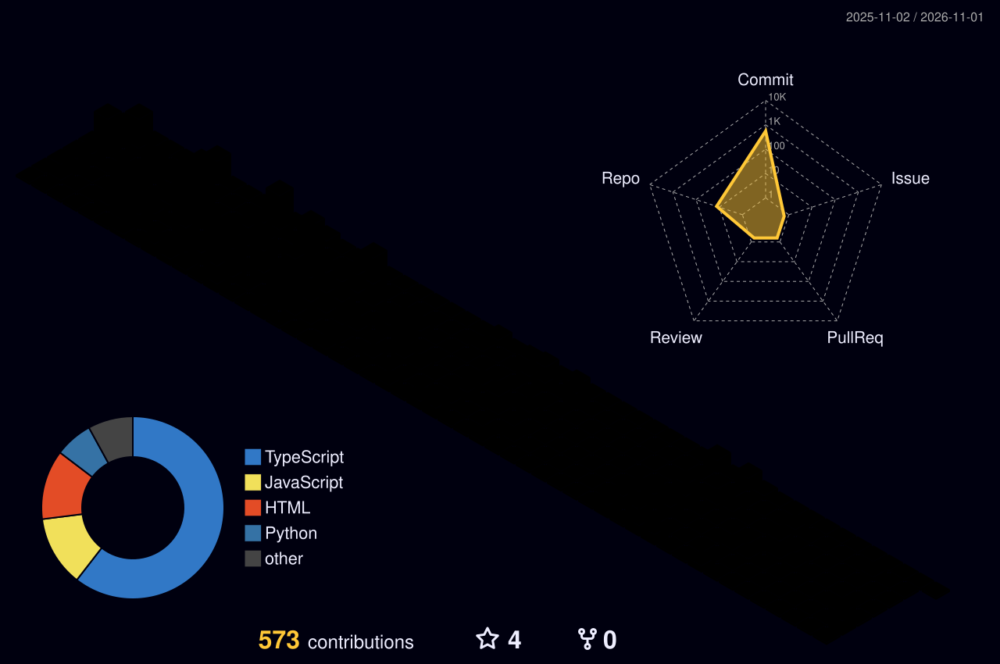

<!-- Futuristic Custom Visual Banner -->

  

## 🌐 Connect with Me:
  

 

# 👋 Hi, I’m @Moubarak-01

- 🎓 **Computer Science Student (4.0 GPA)** at **Rust College**.
- 🎨 **Aspiring Frontend Engineer** with a strong foundation in **Full-Stack development**. I specialize in building reactive, user-centric interfaces for *AI-driven* desktop and web applications.
- 💞️ I’m looking to collaborate on open-source projects and software practices that push the boundaries of AI integration.
- 📫 Reach me at: [alikparahmoubarak@gmail.com](mailto:alikparahmoubarak@gmail.com)
- 😄 Pronouns: **He/Him/His**
- ⚡ **Fun Fact #1:** I'm an artist at heart and I'm really, really good at drawing.
- ⚡ **Fun Fact #2:** I'm a competitive student-athlete currently playing tennis for my college team.

---

# 💻 Tech Stack:

  
  
  
  
  
  

  

---

# 🚀 My Top Projects so far:
| Project | Description | Tech Stack | Status |
| :--- | :--- | :--- | :---: |
| **[Moubely](https://github.com/Moubarak-01/Moubely)** | Stealthy AI Assistant with 18-model waterfall and screen analysis. | `Electron` `React` `Gemini` `Whisper` |  |
| **[Mouvie](https://github.com/Moubarak-01/Movie-Search-App)** | Full-stack discovery app with cold-start optimization. | `React` `Appwrite` `TMDB API` |  |

---

# 🌃 Contribution Village

  <i>Isometric city skyline generated automatically every night from active commits.</i>  
  

---

# 📊 GitHub Stats:

  
  

 

  

 

  

